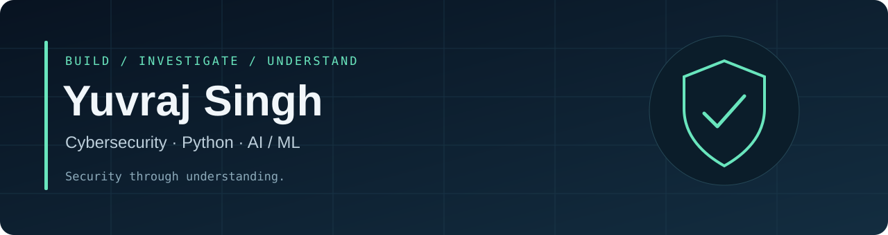

# Yuvraj Singh

  <a href="https://github.com/Yuvraj-26-k?tab=repositories">Projects</a> ·
  <a href="https://github.com/Yuvraj-26-k/cybersecurity-field-notes">Field notes</a> ·
  <a href="mailto:ys9517711034@gmail.com">Contact</a>

I'm **Yuvraj Singh**, a Computer Science student specializing in AI & ML and
working toward a career in cybersecurity. My interests are penetration testing,
web application and network security, Linux, and security automation.

I build Python security-learning tools and document what I can verify. I'm
exploring vulnerability research through authorized labs; I don't present study
notes or tool output as professional experience or confirmed findings.

### Projects

| Project | What it demonstrates | Current scope |
| --- | --- | --- |
| [**Sentinel-AI**](https://github.com/Yuvraj-26-k/Sentinel-AI) | Python TCP scanning, network-event monitoring and optional AI explanations | Learning tool; measured results and uncertain clues stay distinct |
| [**Security Operation Center**](https://github.com/Yuvraj-26-k/Security-Operation-Center) | React/FastAPI dashboard and Windows Sysmon investigation workflows | Local prototype; security hardening and feature validation remain |
| [**Cybersecurity Field Notes**](https://github.com/Yuvraj-26-k/cybersecurity-field-notes) | Structured methodology, learning indexes and report templates | Initial structure; no completed CTF/research reports published yet |

### Focused Python exercises

- [SOC Log Analyzer](https://github.com/Yuvraj-26-k/soc-log-analyzer) — log statistics and indicator-candidate extraction.
- [Security Evidence Collector](https://github.com/Yuvraj-26-k/security-evidence-collector) — shallow file-metadata inventory for DFIR practice.
- [Hash Generator](https://github.com/Yuvraj-26-k/Hash-Generator) — digests of entered text, not file hashing.
- [Starpass](https://github.com/Yuvraj-26-k/Starpass) — a password-utility exercise with documented randomness limitations.

### Learning and research interests

Web authentication and authorization, OWASP vulnerability concepts, network
protocols, Linux permissions, safe reconnaissance, and evidence-based reporting.
My [SQL injection study notes](https://github.com/Yuvraj-26-k/SQL-injection-notes)
remain a learning resource, not a vulnerability-discovery claim.

### Technologies in my projects

| Area | Technologies |
| --- | --- |
| Security automation | Python, standard-library CLI and file-processing tools |
| Network investigation | Linux, Wireshark, Nmap; protocols and log analysis |
| Web prototypes | React, TypeScript, FastAPI, SQLite |
| Academic focus | Artificial intelligence and machine learning |

I also build [SHEild](https://github.com/Yuvraj-26-k/SHEild), a public-safety
prototype. It is separate from my cybersecurity projects and is not a verified
phishing detector.

I practice on owned or authorized systems and value reproducible results,
clear limitations, responsible disclosure and remediation.
